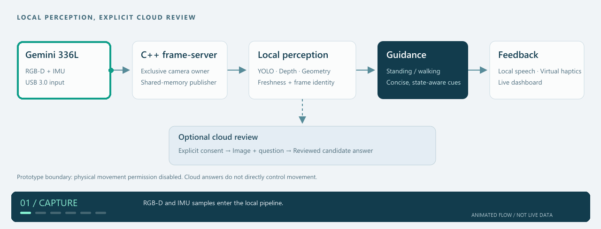

<div align="center">


# LUMINA Guide · 灵犀导盲背心

**看见环境，理解场景，让辅助提示更清晰。**

[简体中文](README.md) · [繁體中文](README.zh-TW.md) · [English](README.en.md)

[](https://github.com/CH-LaTiao/lumina-guide/actions/workflows/static-checks.yml)


[项目能力](#项目能力) · [系统架构](#系统架构) · [快速开始](#快速开始) · [文档导航](#文档导航) · [合作联系](#合作联系)

</div>

---

LUMINA Guide 是面向视障人群的**可穿戴 RGB-D 场景理解与通行提示原型**。项目以 NVIDIA Jetson Orin Nano Super 与 Orbbec Gemini 336L 为基础，将本地感知、简洁语音、虚拟振动和按需云端理解组合在一起，当前定位是**配合白手杖的辅助设备**。

> **公开演示版** · 本仓库展示公开架构、界面、部分工具与测试；商业核心版本闭源，公开版不定期更新。它是研究与工程验证原型，尚未完成自主导航或真实佩戴行走验收，默认 `movement_allowed=false`。

## 项目能力

| 感知环境 | 理解场景 | 输出提示 |
| :--- | :--- | :--- |
| RGB-D 对齐与深度区域诊断 | IMU 站立 / 步行状态 | 结论优先的短句语音 |
| CUDA YOLO11n 目标检测 | 地面、障碍高度与通道分析 | 六通道虚拟振动 |
| 台阶、路缘与近物候选 | 用户授权的图片与问题审阅 | 实时画面、框选与状态可视化 |

### 围绕两种使用状态设计

| 使用状态 | 交互重点 | 示例 |
| :--- | :--- | :--- |
| **站立观察** | 描述方向、近物与环境；按需提出问题 | “前方有什么？” |
| **步行提示** | 保持一句简洁的行动提示；风险优先 | “停，有台阶。” |
| **按需理解** | 经授权发送图片与问题，返回候选答案供审阅 | “帮我理解这个场景。” |

示例用于说明交互设计，不代表具体场景已通过通行验收。云端答案不会直接控制移动或马达。

### 在同一个页面观察整个过程

- **实时感知台**：RGB、对齐深度、检测框、三维诊断、语音与虚拟振动。
- **地面线调节**：拖动水平线调整地面拟合区域，障碍检测仍覆盖完整画面。
- **提示词反馈闭环**：CSV 修订 → 候选版本 → 授权试答 → 人工评测 → 启用 / 回滚。
- **状态可追溯**：显示实际后端、帧龄和运行状态，感知失效时撤回旧方向。

## 系统架构



*循环动画展示系统数据流，并非实时设备遥测。需要静态阅读时可查看 [静态架构图](docs/assets/system-overview.svg)。*

**本地路径**负责持续感知与提示；**在线路径**服务于用户主动提出的场景问题。相机由 C++ 帧服务独占，Python 消费共享内存；站立和步行策略共用可追溯的引导状态。

| 层级 | 主要技术 | 作用 |
| :--- | :--- | :--- |
| 设备与采集 | Jetson · Gemini 336L · C++ | RGB-D、IMU、共享内存 |
| 感知与策略 | Python · OpenCV · ONNX Runtime | 目标检测、几何诊断、引导状态 |
| 语音与反馈 | Piper · eSpeak NG · 虚拟振动 | 本地语音、六通道反馈模拟 |
| 可视化与审阅 | HTML / JavaScript · 可选云端视觉 | 实时感知台、问答与人工评测 |

详细进程与数据流见 [架构文档](docs/architecture.md)。图中背心为系统形态示意，振动为软件模拟。

### 从环境感知到行动提示

系统围绕“采集 → 感知 → 判断 → 反馈 → 人工复核”组织。深度几何回答物体的空间位置，目标检测提供类别线索，IMU 提供运动状态；这些信息共同进入引导策略，再以语音、虚拟振动和可视化状态呈现。复杂场景理解通过独立的在线问答路径补充，避免把本地即时提示绑定到网络响应速度。

| 模块 | 解决的问题 | 工程实现与协作方式 |
| :--- | :--- | :--- |
| **RGB-D 与 IMU 采集** | 持续获取环境与运动信息 | C++ 帧服务独占相机；共享内存发布图像、深度和 IMU 数据，消费者检查帧标识与时间戳 |
| **目标检测与深度关联** | 将类别线索与空间信息结合 | YOLO11n 通过 ONNX Runtime 推理，优先 CUDA；检测结果关联对应图像帧，避免把旧框误贴到新画面 |
| **地面与障碍几何** | 描述地面、物体簇、障碍高度和候选通道 | 使用深度与相机内参进行几何分析；水平地面线限定地面拟合区域，但不屏蔽完整画面的障碍检测 |
| **站立 / 步行策略** | 在信息量和行动及时性之间取得平衡 | 站立时提供环境摘要；步行时使用结论优先短句，结合连续帧确认、风险优先级和过期撤回 |
| **统一反馈状态** | 让语音、方向和振动表达一致 | 本地 Piper 语音与六通道虚拟振动读取同一引导状态；紧急提示优先于一般说明 |
| **在线场景理解** | 回答用户针对当前场景提出的问题 | 场景提示词与问题共同构建请求；授权后提交快照，返回结果经过结构校验与规则审阅 |
| **提示词迭代** | 将人工经验积累为可回溯的配置 | CSV 导出和修订、版本候选、试答评测、启用与回滚；更新提示词配置，不宣称重新训练模型权重 |

### 工程化建设

项目同时建设开发、调试、验证与恢复工具，使各模块可以被观察、定位和迭代。

- **并行处理与相机所有权**：采集、检测、几何分析和页面呈现有明确的数据交接，避免多个进程同时争用相机。
- **证据关联与时效管理**：帧标识、时间戳和会话信息用于判断结果是否仍适用于当前画面；过期数据不继续支持旧方向。
- **统一调试界面**：同时查看图像、检测框、几何结果、引导文字、振动通道和实际运行后端，支持软硬件联调。
- **测试与诊断工具**：包含单元与接口回归、确定性算法场景、运行探针和轨迹记录工具；离线测试与现场验收分别记录。
- **版本与数据恢复**：提供发布版本、运行身份核对、回滚与运行数据备份工具，方便将异常定位到具体版本。
- **人机协同迭代**：将问答、场景、提示词和人工修订纳入审阅流程，为特定场景持续改进提供依据。

### 能力进度与后续方向

| 层面 | 当前建设内容 | 后续验证或发展方向 |
| :--- | :--- | :--- |
| 环境感知 | RGB-D、目标检测、几何诊断和实时可视化 | 不同光照、玻璃、细杆、悬空物体等场景专项验证 |
| 引导交互 | 站立 / 步行策略、短句语音、虚拟振动 | 真实佩戴中的时延、提示稳定性与用户可理解性验证 |
| 深层理解 | 授权图片问答、场景提示词和人工反馈版本管理 | 特定场景的真实问题集与人工评测积累 |
| 导航协同 | 以现场感知和行动提示为当前基础 | 逐步结合导航方向与现场通行信息；地铁线路、站内路径等仍属发展方向 |
| 实体集成 | Jetson 与 336L 原型平台、软件输出链路 | 振动板、穿戴安装、供电续航及受控场地验收 |

公开演示版用于呈现上述系统设计和可公开实现；具体公开范围以 [NOTICE](NOTICE.zh-CN.md) 为准。

## 快速开始

**准备条件：** Jetson Orin Nano Super、Gemini 336L、USB 3.0、匹配的 JetPack / CUDA、独立 Python 环境、Orbbec SDK，以及自行准备的模型。模型、SDK、API Key 和运行数据不随仓库分发。

1. 阅读 [Jetson 安装说明](docs/setup-jetson.md)，完成设备与依赖配置。
2. 按安装文档构建 C++ 帧服务，并配置设备序列号、模型和 SDK 路径。
3. 在 Jetson 的配置环境中启动预览：

```bash
python3 tools/preview_control.py start --lan
python3 tools/preview_control.py status
```

在同一局域网打开 **`http://<JETSON_IP>:8765/`**。在线视觉功能可选，仅在明确授权后发送图片。详见 [安全与隐私](docs/safety-and-privacy.md)。

<details>
<summary><strong>目录与验证入口</strong></summary>

```text
core/          C++采集、共享内存与几何处理
prompts/       场景提示词与JSON Schema
tools/         感知、语音、页面与诊断工具
tests/         单元、接口与回归测试
deployment/    可选部署模板
docs/          架构、安装与安全说明
```

```bash
python3 -m unittest tests.test_live_view_js tests.test_ground_line -v
node --check tools/live_view.js
```

上方 CI 徽章仅对应无硬件静态检查，不表示实机行走或产品安全验收。完整测试和环境要求见 [详细使用说明](docs/public-demo-guide.zh-CN.md)。

</details>

## 文档导航

| 你想了解什么 | 从这里开始 |
| :--- | :--- |
| 设备配置与启动 | [Jetson 安装](docs/setup-jetson.md) |
| 进程、共享内存与数据流 | [系统架构](docs/architecture.md) |
| 完整功能、命令与测试 | [详细使用说明](docs/public-demo-guide.zh-CN.md) |
| 数据处理与使用边界 | [安全与隐私](docs/safety-and-privacy.md) |
| 公开内容与商业版本 | [公开与商业说明](NOTICE.zh-CN.md) |
| 报告安全问题 | [安全策略](SECURITY.zh-CN.md) |

## 当前边界

当前为研究与工程验证原型，**不替代白手杖、导盲犬、陪同人员或交通判断**。实体振动板、真实佩戴行走、距离真值、长期稳定性和用户可用性仍需验收。玻璃、镜面、细杆、悬空物体和楼梯等场景需要专项验证；云端结果也可能超时或出错。

## 资助与公开范围

本项目为 **香港数码港（Cyberport Hong Kong）资助项目**。资助不代表数码港对产品功能、安全性、医疗器械合规性或商业可行性作出认证或背书。

本仓库是公开演示版，**不等同于完整商业版本，也尚未声明开源许可证**。商业核心的关键算法、参数、模型集成、部署配置和现场适配细节不公开。授权范围以 [NOTICE](NOTICE.zh-CN.md) 为准；第三方模型和 SDK 另受各自许可证约束。

## 合作联系

商业授权、产品合作与商业版本咨询：**[wzr0411@gmail.com](mailto:wzr0411@gmail.com)**

---

<div align="center">

**LUMINA Guide** · Wearable perception. Human-centered assistance.

[简体中文](README.md) · [繁體中文](README.zh-TW.md) · [English](README.en.md)

</div>
