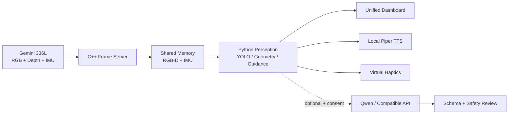

# LUMINA Guide / 灵犀导盲背心

[简体中文](../README.zh-CN.md) | [繁體中文](../README.zh-TW.md) | [English](../README.en.md)

面向视障人士的可穿戴 RGB-D 场景理解与通行提示原型，运行于 **Jetson Orin Nano + Orbbec Gemini 336L**。

> **资助说明 / Funding**  
> 本项目为香港数码港（Cyberport Hong Kong）资助项目。  
> This project is funded by Cyberport Hong Kong.  
> 资助关系不代表数码港对产品功能、安全性、医疗器械合规性或商业可行性作出认证或背书。

> **公开演示版说明 / Public demo notice**  
> 本仓库是公开演示版，仅展示可公开的架构、界面和部分实现。商业化核心版本为闭源软件，关键算法、参数、模型集成、部署配置和现场适配细节未公开，保留技术细节。公开版本会不定期更新，不承诺固定更新周期或完整支持。  
> This repository is a public demo. The commercial core version is closed source; key algorithms, parameters, model integration and deployment details are withheld. Public updates are provided from time to time without a fixed schedule.  
> 商业授权、合作或商业版本咨询：**wzr0411@gmail.com**

项目把实时 RGB/深度、CUDA 目标检测、IMU 步态识别、地面平面诊断、楼梯/路缘候选、本地语音和虚拟振动提示放在同一个本地感知台中。云端视觉语言模型是可选能力，必须单独授权；本地感知、急停和固定短句不依赖云端。

> 这是研究与工程验证原型，不是医疗器械，也不是已经验收的自主导航设备。仓库默认保持 `movement_allowed=false`，所有物理移动和真实振动输出都必须经过场地、佩戴和硬件验收。

## 公开版与商业版

- **公开演示版**：公开可展示的架构、交互、部分工具和测试，用于理解产品方向和验证公开能力。
- **商业核心版**：闭源，包含更完整的核心算法、参数、模型集成、部署配置和项目适配；不在本仓库公开。
- **更新节奏**：公开演示版不定期更新，不承诺固定版本节奏。
- **联系**：商业授权、合作和商业版本咨询请联系 **wzr0411@gmail.com**。
- **资助**：本项目为香港数码港（Cyberport Hong Kong）资助项目；资助不构成产品认证或安全背书。

详见[三语版公开与商业说明](../NOTICE.zh-CN.md)和[安全策略](../SECURITY.zh-CN.md)。

## 当前能力

- **实时感知**：640×480 RGB-D 对齐、共享内存三槽发布、新鲜度检查和相机自动重连。
- **三维诊断**：地面平面 RANSAC、障碍高度范围、连续帧稳定度、地面线和物体簇。
- **手动地面线**：在实时画面中上下拖动一条水平线，线以下作为地面拟合区域，线以上不参与地面拟合。默认 55%，可调 20%–95%。
- **CUDA 检测**：YOLO11n ONNX，优先 `CUDAExecutionProvider`，UI 显示实际后端和耗时。
- **站立/步行策略**：读取 336L IMU；自动切换站立观察和步行短句；转弯时暂停旧路线确认。
- **通行提示**：结论优先，例如“前方可走”“停，改走左侧”“停，有台阶”“停，感知不可用”。
- **本地语音**：Piper `zh_CN-huayan-medium` 常驻进程和预合成短句；eSpeak NG 仅作本地兜底，不使用云端 TTS。
- **虚拟振动**：六通道模拟；未完成身体标定时按相机区域显示，不与真实硬件混用。
- **可选云端审阅**：通过兼容 OpenAI 的消息接口提交单次 RGB 图和问题，结果只作为候选，必须经过 Schema、安全规则和人工审阅。
- **提示词管理**：CSV 修订、候选版本、授权试答、人工评测、启用/回滚。
- **统一感知台**：视频、语音振动、目标检测同屏，三维几何在下方，适合桌面和局域网浏览器查看。

## 架构



关键设计：

1. C++ 帧服务独占相机，Python 预览只读共享内存，避免两个进程同时打开相机。
2. 站立模式给出方向摘要；步行模式只输出一条结论优先短句。
3. 地面线只影响地面拟合，不隐藏障碍；障碍检测始终覆盖完整画面。
4. 云端结果不能直接控制马达或移动，所有移动候选保持阻断。
5. 感知过期、相机断开或决策线程停滞时，旧方向立即撤回。

更多细节见 [架构与进程模型](architecture.md) 和 [安全与隐私](safety-and-privacy.md)。

## 目录

```text
core/          C++ 采集、共享内存、深度区域和几何聚类
prompts/       在线场景提示词与 JSON Schema
deployment/    systemd/udev 可选模板
tools/         Jetson 服务、感知、TTS、在线问答和诊断工具
tests/         Python 单元/接口/回归测试
docs/          架构、安装、安全和隐私说明
```

## 硬件与依赖

已验证环境：

- Jetson Orin Nano Super，Ubuntu 22.04 / L4T 36.x
- Orbbec Gemini 336L，USB 3.0
- CUDA / ONNX Runtime GPU
- Python 3.10
- CMake 3.16+
- OpenCV、NumPy、SciPy、jsonschema
- `pyorbbecsdk`（独立 SDK 虚拟环境）
- Piper 及中文模型、eSpeak NG

模型和相机 SDK **不随本仓库分发**。请自行安装并遵守各自许可证：

- YOLO11n / Ultralytics 模型：AGPL-3.0，使用前请核对项目分发方式。
- Piper 模型和语音：遵循其上游许可证。
- Orbbec SDK：遵循 Orbbec 的 SDK 许可。

## 快速启动

设置自己的设备序列号和模型路径，不要把真实序列号或 API Key 提交到 Git：

```bash
export LUMINA_SERIAL="YOUR_DEVICE_SERIAL"
export LUMINA_YOLO_MODEL="$HOME/ultralytics/ultralytics/yolo11n.onnx"
export LUMINA_SDK_PYTHON="$HOME/lumina-sdk-env/bin/python"
export LUMINA_FRAME_SOURCE=shm
export LUMINA_ORBBEC_EXTENSIONS="$HOME/orbbec-sdk/<sdk-version>/lib/extensions"
```

构建 C++ 部分：

```bash
cmake -S . -B build -DLUMINA_ORBBEC_SDK="$HOME/orbbec-sdk/<sdk-dir>"
cmake --build build -j2
```

启动预览：

```bash
python3 tools/preview_control.py start --lan
```

打开 `http://<JETSON_IP>:8765/`。若只在本机访问，去掉 `--lan` 并使用 SSH 转发。

可选的在线问答密钥只通过标准输入注入：

```bash
python3 tools/preview_control.py start --lan --key-stdin
```

不要把密钥写入 `.env`、脚本、SQLite、日志或 Git。

更完整的 Jetson 安装说明见 [Jetson 安装](setup-jetson.md)。

## 测试

可用普通 Python 环境运行的静态部分：

```bash
python3 -m unittest tests/test_live_view_js.py tests/test_ground_line.py -v
node --check tools/live_view.js
```

完整测试需要 OpenCV、onnxruntime、pyorbbecsdk、原生深度库和相机环境：

```bash
python3 -m pytest -q tests
ctest --test-dir build --output-on-failure
```

本仓库的 GitHub Actions 只运行无硬件的静态检查；Jetson 实时门禁不能由普通 CI 代替。

## 安全边界与已知限制

- 不是医疗器械；不能替代白手杖、导盲犬、陪护或交通判断。
- 默认不授予移动许可，物理振动板尚未完成型号、接线、电源和协议验收。
- 地面线是地面拟合辅助，不是障碍屏蔽；障碍仍从完整画面检测。
- 玻璃、镜面、细杆、悬空物体、楼梯真值和室内外地图仍需专项验证。
- 目前没有完成真实佩戴行走、距离真值、长期稳定性和用户可用性验收。
- 在线模型可能超时、产生不确定语言或错误事实，因此只作为候选项。
- 当前仓库是公开演示版，未声明开源许可证；在添加许可证前，代码可公开查看，但不自动授予复制、修改、再分发或商业使用权利。
- 商业核心版本闭源；商业授权请联系 **wzr0411@gmail.com**。

## 贡献

欢迎提交 issue 和 pull request，尤其是：

- Orbbec / Jetson 兼容性；
- 视障用户可用性测试；
- 台阶、路缘、玻璃、细杆和复杂地面；
- 本地语音质量与延迟；
- 安全审计、隐私和可复现实验。

不要在 issue、测试数据或提交中包含 API Key、设备序列号、相机原图或个人身份信息。
